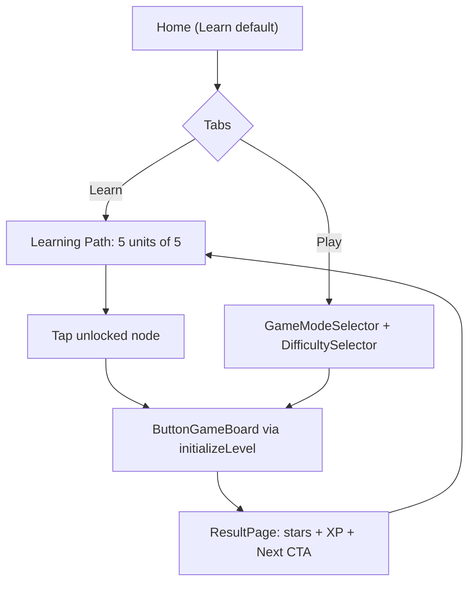

# EPIC-25 — Learning Path & Hybrid Lobby

> File name kept as `EPIC-10-learning-path.md` for URL stability; the canonical
> backlog ID is **EPIC-25** (EPIC-10 is already taken by Keyboard navigation).

**Status:** **shipped in `v0.2.0`** (2026-05-10) — see [`CHANGELOG.md`](../CHANGELOG.md#020--2026-05-10).
**Phase:** 1
**Owner:** —
**Related ADR:** [ADR-003](../DECISIONS.md#adr-003--hybrid-home-learn-default-path-with-play-lobby-as-secondary-tab) — Hybrid Learn-default home with units-of-5 ladder, accuracy-only stars.

> This file is kept as a historical record of the EPIC-25 implementation. Edit only to fix factual errors; new follow-up work goes in `BACKLOG.md` (see "EPIC-25 follow-ups" callout).

## Overview

Add a Duolingo-style **Learn** path as the new default home screen, with the
existing lichess-style **Play** lobby as a secondary tab.

Levels are content-defined (`+` only → `+ −` → `+ − ×` → larger grids), grouped
into **5 units of 5 levels each (25 total)**, with linear unlock and
**accuracy-based 1–3 stars**. The existing game engine is reused with one new
per-level config knob (`allowedOperators`, already a field on `DifficultyConfig`
— just authored per-level instead of per-difficulty).

## Goals

- New player lands on a path and presses one button — no choice paralysis.
- Keep the lichess-style lobby intact (Play tab) for free play and competitive
  modes.
- Curriculum is data, not code, so future curriculum changes don't require an
  engineer.

## Non-goals (this epic)

Cloud sync; hearts / lives / streak freezes; leaderboards; hint system;
audio / SFX; per-unit "review boss" levels; time-based stars. All logged as
Phase 2 placeholders in `BACKLOG.md`.

## Information architecture



## Curriculum (25 levels, units of 5)

Authored as `LEVELS: LevelConfig[]` in
[../../src/constants/levels.ts](../../src/constants/levels.ts) (to be created).

- **Unit 1 — Addition:** 3×3, 2 tiles + 1 op, ops `+`. Target range grows
  L1 → L5.
- **Unit 2 — Subtraction:** 3×3, ops `-`, then `+ -`.
- **Unit 3 — Mixed +/-:** 3×3 then 4×4, 2 or 3 tiles, ops `+ -`.
- **Unit 4 — Multiplication:** 4×4, ops `*` then `+ - *`.
- **Unit 5 — Bigger Grids:** 5×5, hard-class.

`LevelConfig` extends today's `DifficultyConfig` with:

```ts
type LevelConfig = DifficultyConfig & {
  id: string; // "u1-l1"
  unitId: string; // "u1"
  title: string; // "Add it up"
  shortDesc?: string;
};
```

## Engine changes (additive — small)

- [../../src/types/game.ts](../../src/types/game.ts):
  - Add `'learning'` to the `GameMode` union.
  - Add `currentLevelId?: string` and `wrongAttempts: number` to `GameState`.
- [../../src/store/gameStore.ts](../../src/store/gameStore.ts):
  - Add `initializeLevel(levelId: string)` mirroring `initializeGame` but
    consuming a `LevelConfig` from `levels.ts`.
  - Increment `wrongAttempts` on each failed `submitSolution` in learning mode.
- [../../src/utils/gridGenerator.ts](../../src/utils/gridGenerator.ts):
  - Generalize: take a `DifficultyConfig` directly instead of a
    `DifficultyLevel` lookup. Today's two hard-coded shapes `(2 tiles, 1 op)`
    and `(3 tiles, 2 ops)` cover all 25 levels — no algorithm changes, just
    plumbing the config through.
- **No changes** to `calculator.ts`, `NumberTile`, `OperatorIcon`, or
  `ButtonGameBoard` rendering.

## Progress + persistence

New [../../src/store/progressStore.ts](../../src/store/progressStore.ts),
persisted to `localStorage` via `zustand/middleware/persist`.

```ts
type LevelProgress = {
  completed: boolean;
  bestStars: 0 | 1 | 2 | 3;
  bestScore: number;
  playCount: number;
};

type ProgressState = {
  levels: Record<string, LevelProgress>;
  xp: number;
  streak: { count: number; lastPlayedDate: string | null };
  completeLevel: (id: string, stars: 0 | 1 | 2 | 3, score: number) => void;
};
```

**Unlock rule.** L1 of U1 is always unlocked. Any later level unlocks when the
previous level has `bestStars >= 1`. The first level of a unit unlocks when the
last level of the previous unit is completed.

**Why localStorage, not IndexedDB.** Sync, ~25 levels × a few ints — well under
limits. Easy to swap in Phase 2 if cloud sync needs it.

## Stars (accuracy only)

Computed at game-end from `wrongAttempts`:

- **3 stars:** 0 wrong attempts.
- **2 stars:** ≤ 1 wrong attempt.
- **1 star:** completed.

Best-of-N is recorded — repeating a level can only improve `bestStars`, never
regress it.

## XP and streak (Duolingo-lite)

- **XP:** `stars * 10` per level, animated in the header on gain. No level cap,
  no leaderboard yet (Phase 2).
- **Streak:** consecutive UTC days with at least one completion. Small flame in
  the header. **No** streak freezes, **no** push notifications. The vision doc
  explicitly avoids manipulative engagement loops, so we keep this dignified.

## Routing

- `/` → HomeShell (Learn tab default; last-used tab persisted to
  `localStorage`).
- `/learn` → path (= Learn tab content; tabs stay visible).
- `/play` → today's `GameModeSelector` (= Play tab content).
- `/play/difficulty` → today's `DifficultySelector` (only for non-Quick modes).
- `/game?level=u1-l1` → `ButtonGameBoard` via `initializeLevel(levelId)`.
- `/game` (no `level` param) → today's flow via
  `initializeGame(difficulty, gameMode)` from Play.

All Play-side routes preserved so today's lobby works unchanged.

## New UI components

- [../../src/components/UI/HomeShell.tsx](../../src/components/UI/HomeShell.tsx)
  — top tabs `Learn | Play`, header with XP + streak.
- [../../src/components/UI/LearningPath.tsx](../../src/components/UI/LearningPath.tsx)
  — vertical scroll of units.
- [../../src/components/UI/UnitHeader.tsx](../../src/components/UI/UnitHeader.tsx)
  — section divider with unit title + "X/5 complete".
- [../../src/components/UI/LevelNode.tsx](../../src/components/UI/LevelNode.tsx)
  — circular tappable node with stars under it. Locked nodes are visible but
  non-interactive (Duolingo pattern).
- Extend
  [../../src/components/UI/ResultPage.tsx](../../src/components/UI/ResultPage.tsx)
  — stars + XP gain + "Next level" CTA in learning mode; existing behavior
  preserved otherwise.

Visual style: existing Tailwind aesthetic (gradient bg, rounded cards). Subtle
Framer Motion springs on node tap. **Not** Duolingo's mascots/colors.

## Tests

- `progressStore.test.ts` — unlock rules, best-of stars, XP accumulation, streak
  day-rollover (fake timers).
- `gameStore.test.ts` — `initializeLevel` happy path, unknown-level error,
  learning-mode `wrongAttempts` counter.
- `gridGenerator.test.ts` — parametric tests for `+`-only and `+ -`-only
  configs (today's tests don't cover restricted operator sets).
- `LearningPath.test.tsx` — 25 nodes render, lock states match a mocked
  `progressStore`, tap on an unlocked node navigates to `/game?level=...`.
- `HomeShell.test.tsx` — tab switching + last-tab persistence.

## Back-compat

- No existing `localStorage` keys for game progress → no migration needed.
- `gameMode: 'learning'` is purely additive; today's
  `'classic' | 'timeAttack' | 'endless' | 'puzzle' | 'quickGame'` flows are
  untouched.
- Quick Game still works exactly as today (3×3 easy preset) from the Play tab.

## Documentation updates (part of this epic)

- [../VISION.md](../VISION.md) — paragraph reconciling Learn (path) and
  Play (lobby) roles.
- [../ARCHITECTURE.md](../ARCHITECTURE.md) — new "Progress model" section
  describing `progressStore` + persistence + unlock rules.
- [../DECISIONS.md](../DECISIONS.md) — **ADR-003: Hybrid Learn-default home
  with units-of-5 ladder, accuracy-only stars.** Records the four product
  decisions and alternatives considered (pure path, pure lobby, lobby-default,
  time-based stars, units+review).
- [../ROADMAP.md](../ROADMAP.md) — Phase 1 EPIC-25 in progress.
- [../BACKLOG.md](../BACKLOG.md) — EPIC-25 line items + Phase 2 out-of-scope
  placeholders.
- [../CHANGELOG.md](../CHANGELOG.md) — `[Unreleased] → Added` entry.

## Quality gates

After each todo: `npm run lint && tsc --noEmit && npm test`. Final gate adds
`npm run build`. Green at every step.

## Suggested execution order

1. **Content + engine plumbing** — `levels.ts`, `LevelConfig`, generalize
   `gridGenerator` to accept a `DifficultyConfig`, add `initializeLevel`.
2. **`progressStore`** with unlock rules, persistence, and tests.
3. **`HomeShell` + tabs + routing** (Play side keeps working throughout).
4. **`LearningPath` + `UnitHeader` + `LevelNode`** wired to both stores.
5. **`ResultPage`** stars + XP + Next CTA for learning mode.
6. **Smoke tests + final gates.**
7. **Docs sweep** (VISION, ARCHITECTURE, ADR-003, ROADMAP, BACKLOG, CHANGELOG).

## Open questions / risks (raised, not blocking)

- **Play tab clutter.** The current lobby lists modes that aren't actually
  built (Endless, Puzzle). Worth a follow-up to grey them out or remove. Out of
  scope for this epic but flagged here so we don't forget.
- **Streak as opt-in?** Default behavior records streak silently. If we want a
  "no streak ever" preference, that's a small toggle in `progressStore` —
  decide before shipping.
- **StrictMode double-init.** EPIC-05.04 (deferred) becomes more visible in
  learning mode where each level is a fresh mount. Worth doing as a prerequisite
  if the symptom is observable.
